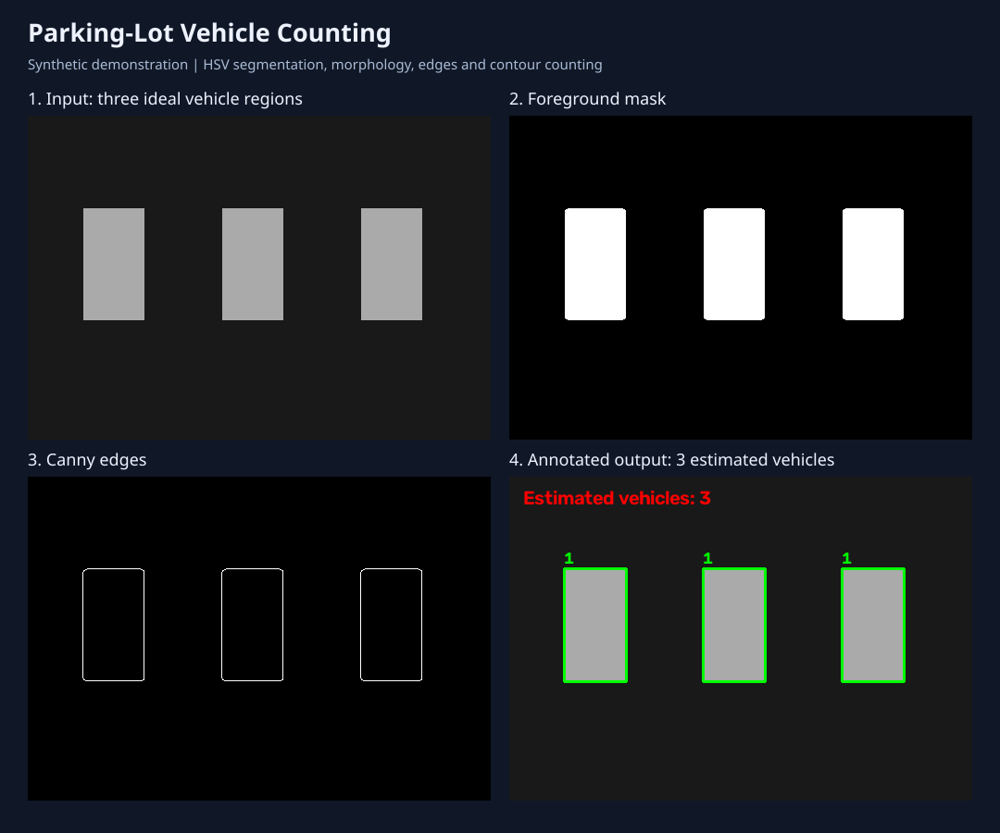
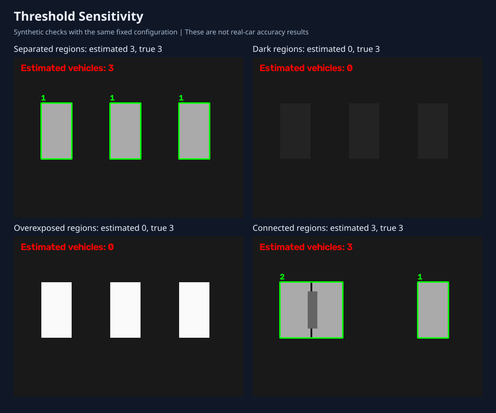

# Parking-Lot Vehicle Detection and Counting

A Python/OpenCV baseline based on Jinxiao Wan's Image Analysis home exam, Task 6. It extracts candidate vehicle regions and estimates the number of parked vehicles. It does not detect parking-space boundaries or determine individual space occupancy.

## Background and method

The original coursework used median filtering, HSV thresholding, morphological closing/opening, Canny edges, external contours and an area-based count heuristic. Shadows sometimes merged nearby cars. Lighting and vehicle orientation also affected results.

This repository rebuilds that pipeline with configurable parameters, a headless command-line interface, intermediate images, JSON results and count evaluation. No neural network is trained. The original `car_train.png` and `car_test.png` are not included; no real-image accuracy is claimed.

## Visual walkthrough



The figure shows actual intermediate outputs from the detector on a synthetic scene: input, foreground mask, edges and estimated count.



Using one fixed configuration, the three separated regions are counted correctly. Dark and overexposed regions are missed because they fall outside the HSV value bounds. The connected-region example is assigned two vehicles by the area heuristic, but the individual cars are not separately localized.

| Synthetic scenario | True count | Estimated count | Absolute error |
| --- | ---: | ---: | ---: |
| Separated regions | 3 | 3 | 0 |
| Dark regions | 3 | 0 | 3 |
| Overexposed regions | 3 | 0 | 3 |
| Connected regions | 3 | 3 | 0 |

These controlled checks illustrate behavior and limitations; they are not a real-world benchmark. Regenerate the figures and machine-readable results with:

```bash
python visualize.py
```

## Run

Python 3.10+; CPU only, no GPU required. From the cloned repository directory:

```bash
python -m venv .venv
# Linux / WSL:
source .venv/bin/activate
# Windows PowerShell instead: .venv\Scripts\Activate.ps1
python -m pip install -r requirements.txt
python demo.py
python detect.py --image outputs/demo/input.png --output outputs/example
python evaluate.py --labels outputs/demo/labels.csv --output outputs/demo/evaluation.json
```

For your own image:

```bash
python detect.py --image data/car_test.png --output outputs/test
```

Outputs: `annotated.png`, `mask.png`, `edges.png`, and `detections.json`. Boxes represent contour regions: a merged region can be assigned an estimated count of two, but this does not localize two separate cars.

## Configure and evaluate

Pass `--config config.json` to detection or evaluation. Only supplied parameters override defaults. For example:

```json
{"hsv_lower": [0, 0, 50], "hsv_upper": [179, 60, 240], "min_area": 1700, "normal_area": 8500, "merged_ratio": 1.5}
```

Tune thresholds on training images only. Freeze the configuration before testing. HSV uses OpenCV ranges H=0–179 and S,V=0–255. Pixel-area thresholds depend on image resolution and camera viewpoint.

Create a CSV with `image,count` columns. Image paths are relative to the CSV directory; counts must be manual ground truth. Evaluate with:

```bash
python evaluate.py --labels data/test_labels.csv --config config.json
```

Report mean absolute count error and exact-count fraction separately for lighting/shadow conditions. These are count metrics, not bounding-box detection precision or recall. The synthetic demo only checks execution on three ideal rectangles and an empty image. It is not evidence of performance on actual cars.

## Limitations and next experiments

- Fixed HSV thresholds can miss colorful or dark cars and include other objects.
- Shadows and touching cars merge contours. The original one-or-two heuristic cannot reliably count larger groups.
- Perspective, image scale and rotation affect rectangle areas.
- Test on the original course images locally, then obtain permission before publishing them.
- Compare the baseline with a learned detector on a labelled real-image test set.
- Extend to parking-space occupancy and temporal consistency only after defining annotations and evaluation metrics.

## References

- Source: Jinxiao Wan, Image Analysis Home Exam, Task 6; accompanying presentation.
- [OpenCV contours](https://docs.opencv.org/4.x/d4/d73/tutorial_py_contours_begin.html)
- [OpenCV HSV thresholding](https://docs.opencv.org/4.x/da/d97/tutorial_threshold_inRange.html)

This repository reconstructs the coursework baseline with AI assistance and adds reproducible visualization and evaluation tools.
